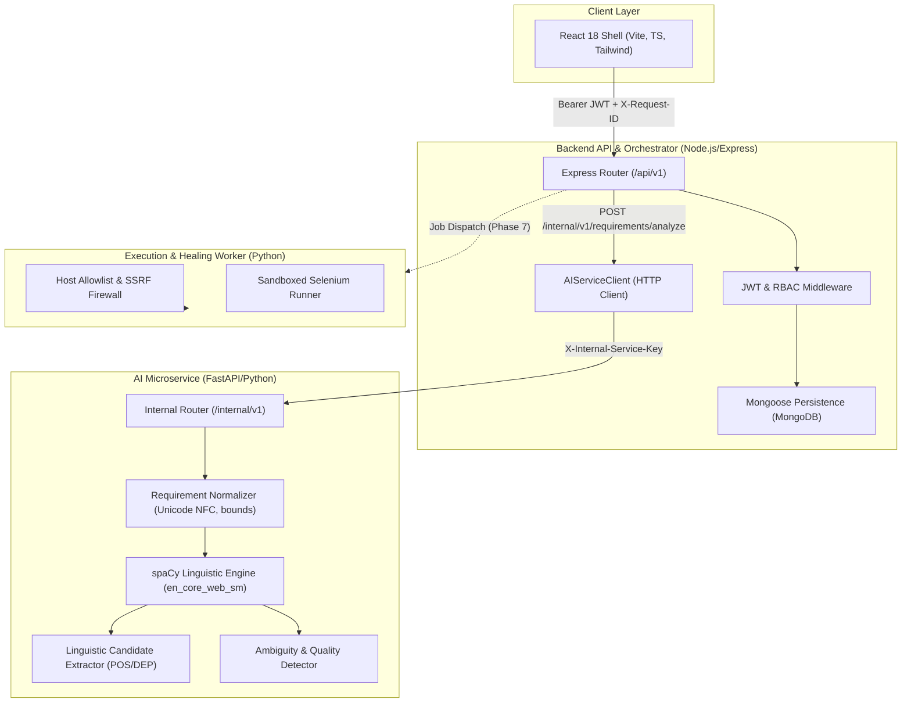

# TestForge AI — Implementation Walkthrough: Phases 0 to 4

> **Platform:** TestForge AI (An Intelligent NLP- and LLM-Powered Automated Test Case Generation and Execution Platform)  
> **Current Milestone:** Completed Phase 4 (ML Dataset and Requirement Classifier)  
> **Next Milestone:** Phase 5 (LLM Provider Integration and Structured Generation)  
> **Status:** All Phase 0–4 gates verified with 78/78 automated tests passing (100%) and zero type errors.

---

## 1. Executive Summary & Architecture Overview

TestForge AI is structured as a decoupled monorepo engineered to eliminate arbitrary LLM code synthesis in browser runtimes. The architecture separates concerns into specialized microservices communicating over authenticated, typed contracts:

1. **Phase 0:** Foundational specifications, legacy audit, and zero-reuse mandate.
2. **Phase 1:** Monorepo scaffold, correlation ID propagation, Pino logging, and automation SSRF safety.
3. **Phase 2:** Persistence (MongoDB/Mongoose), JWT auth & RBAC, and responsive React 18 UI shell.
4. **Phase 3:** Deterministic NLP pipeline (spaCy `en_core_web_sm`), rule-based linguistic candidate extraction, ambiguity and quality warning detection, and frontend linguistic inspection studio.



---

## 2. Phase-by-Phase Features & Deliverables

### Phase 0: Legacy Review & Foundational Architecture
* **Legacy Evaluation:** Analyzed `C:\Projects\AutoHealQA`. Found critical safety vulnerabilities: arbitrary LLM code generation executed in browser runtimes, lack of deterministic NLP, absence of multi-tenant data boundaries, and hardcoded public test sites.
* **Formal Decision:** Decided on **Zero Code Reuse** ([`LEGACY_REVIEW.md`](file:///c:/Projects/TestForge_AI/LEGACY_REVIEW.md)).
* **Architectural Specs Created:**
  * [`docs/architecture.md`](file:///c:/Projects/TestForge_AI/docs/architecture.md): Service boundaries and lifecycles.
  * [`docs/api-contracts.md`](file:///c:/Projects/TestForge_AI/docs/api-contracts.md): Standard error envelopes and internal API contracts.
  * [`docs/data-models.md`](file:///c:/Projects/TestForge_AI/docs/data-models.md): Complete schemas for all platform entities.
  * [`docs/security.md`](file:///c:/Projects/TestForge_AI/docs/security.md): Threat modeling and defense-in-depth policies.
  * [`docs/evaluation-plan.md`](file:///c:/Projects/TestForge_AI/docs/evaluation-plan.md): Benchmark metrics for extraction and test synthesis.

---

### Phase 1: Monorepo Foundation & Platform Baseline
* **Monorepo Layout:** npm workspaces for frontend/backend, Python virtual environments for AI and automation services.
* **Cross-Cutting Concerns:**
  * Request correlation IDs (`X-Request-ID`) generated and propagated across all service hops via [`correlationId.ts`](file:///c:/Projects/TestForge_AI/backend/src/middleware/correlationId.ts).
  * Structured JSON logging using Pino and standard error handlers.
  * Strict configuration validation: Zod in backend ([`env.ts`](file:///c:/Projects/TestForge_AI/backend/src/config/env.ts)) and Pydantic-settings in Python ([`config.py`](file:///c:/Projects/TestForge_AI/ai-service/app/core/config.py)).
* **SSRF Firewall & Allowlist:**
  * Implemented [`HostAllowlistChecker`](file:///c:/Projects/TestForge_AI/automation/src/safety/allowlist.py) blocking cloud metadata IPs (`169.254.169.254`), link-local IPs, and private subnets (`10.0.0.0/8`, `172.16.0.0/12`, `192.168.0.0/16`).
  * Offline test fixture app in [`automation/fixture_app/index.html`](file:///c:/Projects/TestForge_AI/automation/fixture_app/index.html).

---

### Phase 2: Core Persistence, REST APIs, & Application Shell
* **Mongoose Models:** [`User`](file:///c:/Projects/TestForge_AI/backend/src/models/User.ts), [`Project`](file:///c:/Projects/TestForge_AI/backend/src/models/Project.ts), [`Requirement`](file:///c:/Projects/TestForge_AI/backend/src/models/Requirement.ts), and [`TargetEnvironment`](file:///c:/Projects/TestForge_AI/backend/src/models/TargetEnvironment.ts) with compound indexes and validation.
* **REST APIs:** `/api/v1/auth`, `/api/v1/projects`, `/api/v1/projects/:projectId/requirements`, `/api/v1/requirements/:requirementId`, `/api/v1/projects/:projectId/environments`.
* **RBAC & Security:** Project role middleware (`requireProjectRole`), bcrypt password hashing, JWT bearer tokens, and brute-force rate limiters.
* **OpenAPI 3.0 Documentation:** Served dynamically at `/api/v1/openapi.yaml` from [`docs/openapi.yaml`](file:///c:/Projects/TestForge_AI/docs/openapi.yaml).
* **Database Seeder:** [`seed.ts`](file:///c:/Projects/TestForge_AI/backend/src/scripts/seed.ts) with default personas (`admin@testforge.ai`, `qa@testforge.ai`, `viewer@testforge.ai`).
* **Frontend Shell:** React 18, Vite, Tailwind CSS with [`AuthContext.tsx`](file:///c:/Projects/TestForge_AI/frontend/src/context/AuthContext.tsx), [`LoginForm.tsx`](file:///c:/Projects/TestForge_AI/frontend/src/components/LoginForm.tsx), [`ProjectsView.tsx`](file:///c:/Projects/TestForge_AI/frontend/src/features/projects/ProjectsView.tsx), and [`EnvironmentsView.tsx`](file:///c:/Projects/TestForge_AI/frontend/src/features/environments/EnvironmentsView.tsx).

---

### Phase 3: Deterministic NLP Requirement Analysis & Candidate Extraction
Phase 3 integrates deterministic natural-language processing into the platform, converting raw textual requirements into traceable, structured linguistic features without hallucinations or dynamic code generation.

#### 1. Text Normalization Pipeline
* Implemented [`RequirementNormalizer`](file:///c:/Projects/TestForge_AI/ai-service/app/nlp/normalizer.py):
  * **Size & Boundary Validation:** Enforces strict bounds (5 to 4,000 characters). Rejects empty or whitespace-only inputs.
  * **Unicode NFC Normalization:** Standardizes unicode accents and combining characters.
  * **Sanitization:** Strips non-printable ASCII/Unicode control characters without corrupting meaningful punctuation (`< >`, quotes, colons).
  * **Whitespace Collapsing:** Standardizes runs of spaces, tabs, and carriage returns into single spaces while preserving semantic sentence breaks.
  * **Meaning Preservation:** Retains negation keywords (`not`, `never`, `cannot`), domain identifiers, and quantitative tokens.

#### 2. spaCy Linguistic Feature Extraction
* Integrated spaCy `en_core_web_sm` (v3.8.0) into [`LinguisticCandidateExtractor`](file:///c:/Projects/TestForge_AI/ai-service/app/nlp/extractor.py):
  * **Actors & Initiators:** Extracts dependency subjects (`nsubj`, `nsubjpass`) and compound noun chunks (e.g., `customer`, `admin user`, `system`).
  * **Actions & Verbs:** Identifies actionable verbal predicates and canonical UI verbs (e.g., `click`, `enter`, `select`, `lock`, `display`).
  * **Entities & Objects:** Captures direct objects (`dobj`, `obj`) and prepositional targets (e.g., `login form`, `password`, `lockout message`).
  * **Conditions & Pre-conditions:** Identifies subordinate and adverbial clauses triggered by `when`, `if`, `given`, `in case`, `unless`.
  * **Constraints & Thresholds:** Extracts quantitative thresholds, numeric counts, and temporal durations (e.g., `15 minutes`, `three consecutive times`, `at least 8 characters`).
  * **Expected Outcomes:** Extracts modal-governed outcome clauses (`must be locked for 15 minutes`, `display an informative lockout message`).
  * **Explicit Negation Markers:** Captures negative modifiers (`not`, `never`, `cannot`, `without`) and their governing verbs.
  * **Traceable Evidence Spans:** Maps every extracted candidate to exact character start/end offsets (`start_char`, `end_char`) with confidence scores.

#### 3. Quality & Ambiguity Heuristics
* Implemented [`AmbiguityDetector`](file:///c:/Projects/TestForge_AI/ai-service/app/nlp/ambiguity.py):
  * **Vague / Subjective Terms:** Flags terms like `user-friendly`, `fast`, `intuitive`, `seamless`, `robust`, `properly`, `as soon as possible`.
  * **Non-Normative Weak Modals:** Flags permissive or non-binding modals (`might`, `could`, `may`, `should`) that violate deterministic testing criteria.
  * **Unbounded Quantifiers:** Detects `some`, `several`, `many`, `few`, `various`, `etc.`, `and so on`.
  * **Passive Voice without Agent:** Detects passive constructions omitting the responsible actor (e.g., `the button must be clicked`).
  * **Missing Expected Outcomes:** Flags conditional requirements (`When...`) that omit an explicit verifiable system response.

#### 4. API & Backend Orchestration
* **Internal AI Endpoint:** `POST /internal/v1/requirements/analyze` protected by `X-Internal-Service-Key` in [`requirements.py`](file:///c:/Projects/TestForge_AI/ai-service/app/api/v1/requirements.py).
* **Backend Integration Client:** Created [`AIServiceClient`](file:///c:/Projects/TestForge_AI/backend/src/services/aiService.ts) with timeout and graceful fallback to `draft` if the AI service is unreachable.
* **Mongoose Schema Update:** Updated [`Requirement.ts`](file:///c:/Projects/TestForge_AI/backend/src/models/Requirement.ts) with `nlp_analysis`, `explicit_negations`, `evidence_spans`, and `processing_version`.
* **Explicit Analysis Endpoint:** Added `POST /api/v1/requirements/:requirementId/analyze` in [`requirements.router.ts`](file:///c:/Projects/TestForge_AI/backend/src/modules/requirements/requirements.router.ts).

#### 5. Frontend Requirement Studio Enhancement
* Updated [`RequirementsView.tsx`](file:///c:/Projects/TestForge_AI/frontend/src/features/requirements/RequirementsView.tsx):
  * Visual badges for extracted **Actors** (blue), **Actions** (purple), **Entities** (emerald), **Constraints** (cyan), **Conditions** (amber), and **Outcomes** (indigo).
  * **Ambiguity Warning Banner:** Highlights ambiguous phrases with specific testability feedback.
  * **Interactive Analysis Trigger:** "Run NLP Analysis" button for real-time requirement analysis and re-analysis.

---

### Phase 4: ML Dataset and Requirement Classifier
Phase 4 introduces a reproducible machine learning classification system to categorize software requirements into functional testing domains, computing calibrated confidence distributions and surfacing uncertainty flags.

#### 1. Label Taxonomy & Dataset Provenance
* **Functional Taxonomy (6 Classes):**
  * `authentication`: Login, session management, multi-factor auth, logout, password policies.
  * `validation`: Form field bounds, regex formatting, character limits, type constraints.
  * `business_logic`: Multi-step workflows, discounts, checkout rules, state calculations.
  * `security`: Role-based access, csrf/cors policies, token tampering, privilege checks.
  * `error_handling`: Network timeouts, service degradations, graceful failures, recovery.
  * `data_integrity`: Database consistency, foreign keys, concurrent updates, idempotency.
* **Balanced Dataset:**
  * Curated 108 verified, clean requirement samples (18 samples strictly balanced per class) in [`requirements_dataset.json`](file:///c:/Projects/TestForge_AI/ai-service/data/requirements_dataset.json).
  * Dataset manifest and audit documentation in [`dataset_manifest.json`](file:///c:/Projects/TestForge_AI/ai-service/data/dataset_manifest.json).

#### 2. Reproducible Training Pipeline & Evaluation
* Implemented [`train.py`](file:///c:/Projects/TestForge_AI/ai-service/app/ml/train.py):
  * **Stratified Split:** 70% Train (75 samples), 15% Validation (16 samples), 15% Held-Out Test (17 samples) using fixed `random_state=42`.
  * **Preprocessing:** Pipeline preprocessed using [`RequirementNormalizer`](file:///c:/Projects/TestForge_AI/ai-service/app/nlp/normalizer.py) ensuring identical normalization across training and production inference.
  * **Feature Extraction & Estimator:** `TfidfVectorizer(ngram_range=(1, 2), max_features=1000)` coupled with balanced `LogisticRegression(C=2.0, max_iter=1000)`.
  * **Baseline Model:** Evaluated against `DummyClassifier(strategy="stratified", random_state=42)`.
* **Measured Evaluation Results on Held-Out Test Set:**
  * **Trained Classifier:** Accuracy: **0.7059** | Macro F1: **0.7048** | Weighted F1: **0.7070**
  * **Dummy Baseline:** Accuracy: **0.1765** | Macro F1: **0.0500** | Weighted F1: **0.1765**
  * Artifacts saved: [`model.joblib`](file:///c:/Projects/TestForge_AI/ai-service/app/ml/artifacts/model.joblib), [`model_metadata.json`](file:///c:/Projects/TestForge_AI/ai-service/app/ml/artifacts/model_metadata.json), and [`evaluation_report.md`](file:///c:/Projects/TestForge_AI/ai-service/app/ml/artifacts/evaluation_report.md).

#### 3. Inference Service & Uncertainty Detection
* Implemented [`RequirementClassifierService`](file:///c:/Projects/TestForge_AI/ai-service/app/ml/classifier.py):
  * Computes normalized probability distribution across all 6 classes.
  * Surfaces `is_uncertain: true` when top class confidence falls below 0.20 or top-2 probability margin is less than 0.05.
  * Fallback handling for unassessed models.
* Internal API route [`classifier.py`](file:///c:/Projects/TestForge_AI/ai-service/app/api/v1/classifier.py): `POST /internal/v1/classifier/predict`.

#### 4. Full-Stack Integration
* **Backend:** Added `AIServiceClient.classifyRequirement` in [`aiService.ts`](file:///c:/Projects/TestForge_AI/backend/src/services/aiService.ts), invoked automatically upon requirement creation, update, and analysis.
* **Frontend:** Added `Brain` icon badge to [`RequirementsView.tsx`](file:///c:/Projects/TestForge_AI/frontend/src/features/requirements/RequirementsView.tsx) displaying predicted category, confidence percentage, and an amber alert indicator when predictions are marked uncertain.

---

## 3. Verification & Test Evidence

All 78 tests across the four project components are passing (100% pass rate):

| Component | Test Runner | Test Files | Total Tests | Status | Passing | Failing |
| :--- | :--- | :---: | :---: | :---: | :---: | :---: |
| **AI Service (NLP & ML)** | Pytest | 7 | 44 | **PASS** | **44** | 0 |
| **Backend API & Persistence** | Vitest + Supertest | 4 | 20 | **PASS** | **20** | 0 |
| **Frontend UI Components** | Vitest + Testing Library | 3 | 10 | **PASS** | **10** | 0 |
| **Automation Worker Safety** | Pytest | 1 | 4 | **PASS** | **4** | 0 |
| **Monorepo Total** | | **15** | **78** | **PASS** | **78 (100%)** | **0** |

### TypeScript Compilation Status
* `backend`: `tsc --noEmit` $\to$ **0 errors**.
* `frontend`: `tsc && vite build` $\to$ **0 errors**.

---

## 4. How to Run and Verify Locally

### 1. Run All Automated Test Suites
```powershell
# 1. AI Service Tests (spaCy NLP, Normalizer, Ambiguity, ML Classifier, APIs)
cd c:\Projects\TestForge_AI
.\ai-service\.venv\Scripts\pytest -c ai-service/pyproject.toml ai-service/tests

# 2. Backend Integration Tests (Mongoose, Auth, RBAC, Requirements, AI Client)
cd c:\Projects\TestForge_AI\backend
npm test

# 3. Frontend Component Tests
cd c:\Projects\TestForge_AI\frontend
npm test

# 4. Automation Safety Tests
cd c:\Projects\TestForge_AI
$env:PYTHONPATH="automation"; .\ai-service\.venv\Scripts\python.exe -m pytest automation/tests
```

### 2. Launch Services
```powershell
# Terminal 1: AI Service (Port 8000)
cd c:\Projects\TestForge_AI\ai-service
.\.venv\Scripts\uvicorn app.main:app --port 8000

# Terminal 2: Backend API (Port 4000)
cd c:\Projects\TestForge_AI\backend
npm run dev

# Terminal 3: Frontend UI (Port 5173)
cd c:\Projects\TestForge_AI\frontend
npm run dev
```

Navigate to `http://localhost:5173`, log in with `admin@testforge.ai` / `AdminPass123!`, open the **Requirement Studio**, and inspect the extracted linguistic candidates, ML categorization badge, and ambiguity alerts.

---

## 5. Next Phase Preview: Phase 5

With Phase 4 verified, the platform moves to **Phase 5 (LLM Provider Integration and Structured Generation)**:
* **Provider-Independent Interface:** `LLMProviderAdapter` supporting pluggable providers (Google Gemini, OpenAI, Claude, Mock).
* **Server-Side API Key & Secrets:** Validated environment configuration without exposing credentials to client bundles.
* **Structured Generation Contract:** JSON Schema / Pydantic models for test-case generation matching `Spec.md` Section 7.1 (`positive`, `negative`, `boundary`, `authorization`, `error_handling`, `state_transition`).
* **Generation Jobs & Lifecycle:** Generation job transitions (`queued`, `processing`, `completed`, `failed`), timeouts, token limits, and bounded retries.
* **Mock Provider & Fallbacks:** Deterministic mocked provider for tests, graceful error handling for quota/rate limits/refusals.
